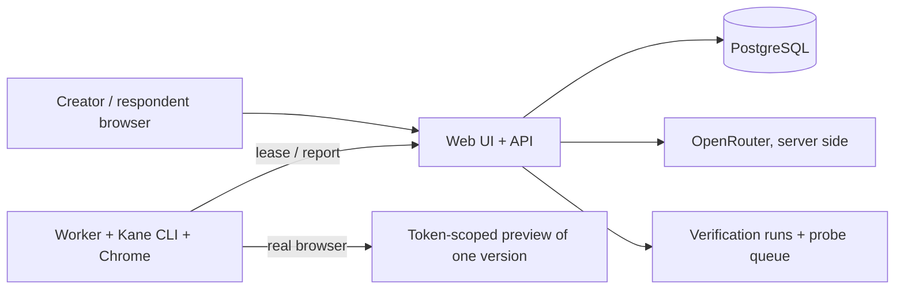

# NIARVA

**From Intention to Proof.**

NIARVA turns requirements into conditional forms, verifies their behavior in a real browser with [Kane CLI](https://www.testmuai.com/docs/kane-cli-installation), and blocks publishing until the required behavior is proven for the exact version.

> Built for the KaneCLI Online Hackathon (12–19 November 2026). Status and limitations are stated honestly below; every verification claim in this repository is backed by recorded evidence under [`evidence/`](evidence).

## The problem

AI can produce a form that is syntactically valid but semantically wrong. A scholarship rule written as `gpa > 3.5` instead of `gpa ≥ 3.5` renders fine, passes a schema check, and still lets an applicant with exactly 3.5 skip the achievement certificate. Ordinary form builders cannot show that what was approved is what the browser, the payload, and the server actually do.

## What NIARVA does

```text
Plain language → approved claims (hashed) → generated form version (immutable)
  → exhaustive static check against the claims → counterexample (e.g. GPA = 3.50)
  → bounded repair proposal → your approval → new version
  → Kane CLI in a real browser + server contract checks → verdict by NIARVA
  → publish gate (fails closed) → public form → respondent receipt
```

- **Approved intent is the oracle.** Claims are typed, quoted from the source text, rendered as deterministic sentences ("GPA ≥ 3.5 (3.5 included)"), approved by the creator, and frozen with a SHA-256 hash.
- **Deterministic engine.** A declarative rule DSL (no `eval`, no code) with exact decimal arithmetic. Every input partition, including the boundary values `t − ε`, `t`, and `t + ε`, is checked against the claims, so `gt` versus `gte` is found with the witness `GPA = 3.50`.
- **Kane observes, NIARVA decides.** Browser probes are derived from the approved claims. Kane CLI drives a real Chrome through the private preview of the exact version and stores typed observations. NIARVA compares them with the oracle: a valid mismatch is FAIL even if Kane says `passed`; timeouts, missing observations, and infrastructure errors are UNKNOWN and never PASS.
- **Controlled repair.** Repairs are a small allowlist of DSL operations, validated by the engine against the unchanged claims, applied only with the creator's approval, and always produce a new version that must be verified again.
- **Version-bound proof and a fail-closed gate.** Proof is bound to the workspace, form, version, claims hash, definition hash, renderer build, runtime configuration, environment, and probe policy. Publishing runs inside a database transaction and is enforced by the backend, whatever the UI shows. After a failed run, two consecutive fresh verified runs are required.
- **Respondent safety.** Hidden fields are removed from the page and never stored; the server validates every submission again; submissions are idempotent across republication.

## Architecture

```text
apps/web        Next.js (App Router): creator workspace, preview, public forms, REST API
apps/worker     Long-running Node worker: leases probes, runs Kane CLI + Chrome, reports raw results
packages/core   Pure engine: DSL, decimals, evaluation, analysis, repair, probes, verdicts, gate
packages/contracts  Shared API error contract
m0-lab          Isolated fixture used to validate Kane CLI at runtime (not product code)
evidence        Sanitized evidence: M0 report, development loop, product loop
```



Chrome and Kane never run inside a serverless function: the worker is a separate process that pulls work over HTTPS.

## How Kane CLI is used

1. **Runtime validation (M0).** Before any feature depended on it, Kane CLI 0.10.4 was exercised against an isolated lab form with labeled faults: stream contract, exit codes, timeouts, secret masking, evidence packs, credits, consistency, and failure detection. Results and the design decisions they forced are in [`evidence/m0/M0_REPORT.md`](evidence/m0/M0_REPORT.md).
2. **Test design (Kane Assurance).** The requirements were ingested with `kane-cli context ingest`; the owner reviewed the use cases and designs; `kane-cli design tests` produced the browser tests in [`.testmuai/tests/`](.testmuai/tests). None were hand-written.
3. **Development testing.** Kane CLI is the only browser test runner in this repository: `pnpm verify:kane <test>` runs designed tests through `kane-cli testmd run`, records the outcome, credits, evidence pack digest, and the source revision.
4. **Product verification.** The worker runs `kane-cli run --agent --headless` for every derived probe of a form version, passing the token-scoped preview URL only as a secret variable.

## Quick start

Prerequisites: Node.js 24, pnpm 12, Google Chrome, and for browser verification an authenticated Kane CLI (`npm install -g @testmuai/kane-cli`, then `kane-cli login`).

```bash
pnpm install
pnpm setup:env       # creates .env.local with generated secrets
pnpm build && pnpm start
```

Open http://localhost:3000, create an account, and start from the scholarship template. Without `DATABASE_URL`, an embedded PostgreSQL (PGlite) is stored in `apps/web/.pglite`; set `DATABASE_URL` to use your own PostgreSQL (`pnpm db:migrate` applies migrations).

Start the worker in a second terminal to enable browser verification:

```bash
pnpm worker
```

AI drafting is optional: set `OPENROUTER_API_KEY` and `OPENROUTER_MODEL` (one model or a comma-separated fallback list) in `.env.local`. Without them, the AI path says so and the template or manual path is used.

## Deployment

The web app deploys to Vercel with a Postgres database; the verification worker, Kane CLI, and Chrome stay on a separate machine and connect over HTTPS. Step-by-step guide: [`docs/deployment/VERCEL.md`](docs/deployment/VERCEL.md).

Live deployment: **https://niarva.vercel.app** (from `main`, Neon Postgres, environment id `vercel-production`). The deployment record, the production closed loop verified with Kane CLI, and the Kane smoke results are in [`evidence/deploy/VERCEL-PROD-01.md`](evidence/deploy/VERCEL-PROD-01.md). Browser verification only progresses while the worker machine is running. Judges can use a synthetic account with read-only access to the recorded golden case; its credentials are provided in the submission form only (setup: [`docs/deployment/VERCEL.md`](docs/deployment/VERCEL.md) §6).

## Environment variables

See [`.env.example`](.env.example). Secrets (`BETTER_AUTH_SECRET`, `PREVIEW_TOKEN_SECRET`, `IP_HASH_SECRET`, `WORKER_SHARED_TOKEN`) are generated by `pnpm setup:env`. Never commit `.env.local`.

## Testing

| Layer | Command | What it proves |
|---|---|---|
| Lint and types | `pnpm lint`, `pnpm typecheck` | Static correctness, domain purity rules |
| Engine | `pnpm test:unit` | Analysis, repair, probes, verdicts on real Kane streams, property tests (10,000 cases) |
| Server | `pnpm test:integration` | Auth isolation, immutability triggers, publish gate, idempotency, instability (PGlite and PostgreSQL 16 in CI) |
| Browser | `pnpm verify:kane <test-id>` | Kane CLI in a real browser against the running app |

## Evidence

- [`evidence/m0/`](evidence/m0): Kane CLI runtime validation, 28 recorded runs.
- [`evidence/dev-loop/`](evidence/dev-loop): development closed loop. [`DEV-LOOP-01.md`](evidence/dev-loop/DEV-LOOP-01.md) records a real Kane CLI failure, the source repair, and the same test passing again. [`regression.md`](evidence/dev-loop/regression.md) lists every regression run after it, including failures, runs that never started, and which steps Kane replayed.
- [`evidence/product-loop/PROD-LOOP-01.md`](evidence/product-loop/PROD-LOOP-01.md): product closed loop with a real worker and Kane CLI. The seeded `gt` defect is confirmed in a real browser (Kane reported `passed`; NIARVA judged FAIL from its observations), the creator approves a bounded repair, publishing is refused before proof, the fresh full suite is VERIFIED (8/8), publishing then succeeds, and a respondent receives a receipt. Failed and interrupted attempts are listed too.
- [`evidence/dev-loop/DEV-LOOP-02.md`](evidence/dev-loop/DEV-LOOP-02.md): a Kane UNKNOWN found during product verification, the repair of NIARVA's probe objectives, and the same probe passing again.
- [`evidence/dev-loop/DEV-LOOP-03.md`](evidence/dev-loop/DEV-LOOP-03.md): a Kane security test typed `alert(1)` into a numeric rule; the edit was stored and the workspace then failed with HTTP 500. The source was repaired, and the repair is proven by native integration tests. The Kane rerun of that test has not passed yet: it failed while replaying a stale recording (see the Assurance records below).
- [`evidence/dev-loop/DEV-LOOP-04.md`](evidence/dev-loop/DEV-LOOP-04.md): a Kane test found that a failed responses request made the owner's view say "No responses yet". The source was repaired (error state with Try again, plus paging), and the same test passed.
- [`evidence/dev-loop/DEV-LOOP-05.md`](evidence/dev-loop/DEV-LOOP-05.md): Kane, signed in as the scoped judge on the live deployment, found that after a repair the seeded version's failing proof was no longer visible. The source was repaired (earlier versions keep their runs and repairs), and the same test passed on the redeployed site.
- [`evidence/assurance/PROD-ASSURANCE-01.md`](evidence/assurance/PROD-ASSURANCE-01.md): every Assurance-designed test run on the live deployment on 18 November, including failures, runs that never started, and how each FAIL was classified.
- [`evidence/deploy/VERCEL-PROD-01.md`](evidence/deploy/VERCEL-PROD-01.md): the product closed loop on the live deployment (VERIFIED 8/8, publish 409 before proof and 201 after, receipt `VCBFQ6AM`) and the Kane smoke tests on the deployment, including the blocked first batch.
- [`evidence/fresh-clone/FRESH-CLONE-01.md`](evidence/fresh-clone/FRESH-CLONE-01.md): the quick start above, run from a fresh public clone without credentials.
- [`evidence/assurance/`](evidence/assurance): Kane Assurance-designed tests for publishing, respondents, access security, and verification honesty, with every FAIL and its classification.
- [`docs/testing/`](docs/testing): how testing is organized, the Test Manager consolidation, test case mapping, every Kane execution, defect traceability, and an evidence index that leads from each claim to its execution.
- All new Kane CLI sessions go to one Test Manager project, **NIARVA intent verification** (`01M7N0CKZ90R3JR906713EHYW0`); the runners refuse any other project. Sessions from 17 November 2026, including the M0 lab, stay in the account's default project "KaneAI Generated" as the historical record. Two runs made after the profile was switched still landed there because their tests had recordings bound to it; see [`docs/testing/MIGRATION_REPORT.md`](docs/testing/MIGRATION_REPORT.md).
- [`docs/integration/API_CONTRACT.md`](docs/integration/API_CONTRACT.md): the HTTP API, the form-state contract, shared components, and the hooks Kane tests rely on.

## Verification status

What Kane CLI has proven, and what it has not. Details and run IDs: [`docs/testing/KANE_EXECUTION_REPORT.md`](docs/testing/KANE_EXECUTION_REPORT.md).

- **Proven in a real browser, judged by NIARVA:** the golden scholarship loop, both locally and on the live deployment. The seeded `gt` defect is confirmed at GPA 3.50, a repair is approved with unchanged claims, the full suite is VERIFIED 8/8, publishing is refused before proof and accepted after it, and a respondent receives a receipt.
- **Assurance-designed tests (64 in total):** by latest recorded run, **24 PASS, 16 FAIL, 24 NOT RUN**. Most FAILs are inconclusive: Kane could not capture a request that had already completed, could not make an authenticated API call, or did not finish its own check. They still count as FAIL. Where the same behavior is covered by native integration tests or the server contract probe, that coverage is listed separately and is not counted as Kane proof.
- **Proven by Kane as the scoped judge on the live deployment:** entering the demo without any provider secret, following the seeded `gt` mismatch to its failed report with run ID, objective, expected and observed, pack reference, and lineage, and inspecting the provenance of the real VERIFIED run ([`PROD-ASSURANCE-01`](evidence/assurance/PROD-ASSURANCE-01.md)).
- **Not proven by Kane:** layouts narrower than 800 px, reduced motion, browser zoom, AI intake and provider outage, and paging of the owner's responses. The responses view's error, loading, and empty states are proven on a local build only.

## Security notes and limitations

- Verification covers the supported DSL scenarios for a specific form version; it is not a guarantee of complete correctness.
- Desktop Kane CLI cannot verify viewports narrower than 800 px on this setup; narrow mobile layouts are reviewed manually and labeled as such.
- Preview tokens are HMAC-signed, scoped to one version and probe run, and short-lived. Sealed Kane evidence packs can contain the preview URL and therefore stay private; only digests and redacted derivatives are published.
- Respondent IP addresses are stored only as keyed hashes. Use synthetic data in demos.

## Disclosure

NIARVA was built during the hackathon build window with AI coding agents (Claude Code for the engine, backend, AI extraction, and verification; OpenAI Codex in parallel for UI work) and Kane CLI. Every commit is made under the repository owner's identity; agent involvement is disclosed here rather than in commit trailers. Seeded defects (the `gt` scholarship rule and the M0 lab faults) are intentional, labeled demonstration cases.

## License

[MIT](LICENSE)
