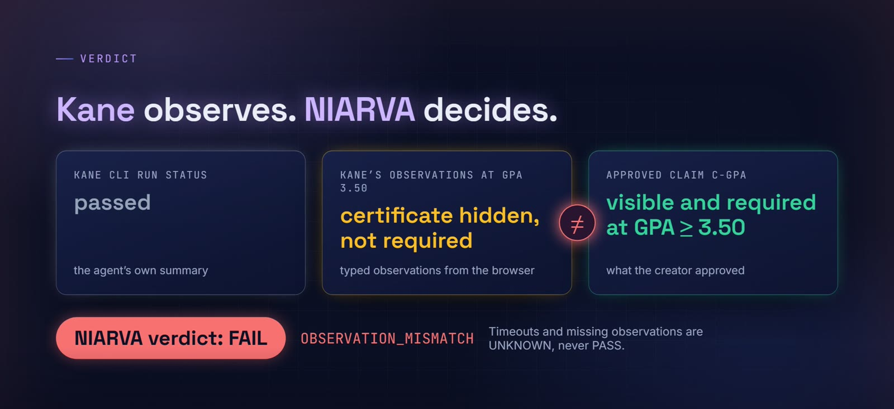

<div align="center">

# NIARVA

**From intention to proof.**

Conditional forms, proven against what their creator approved, in a real browser, before anyone fills them in.

[Live demo](https://niarva.vercel.app) &nbsp;·&nbsp; [Watch the demo](https://youtu.be/1HWLSNiFpPk) &nbsp;·&nbsp; [Evidence](evidence)

</div>

<br>

<!--
  Hero preview: a frame from the demo video, linked to the video.
  To use another screenshot or a GIF, replace docs/assets/demo-preview.jpg or change the src below.
-->
<a href="https://youtu.be/1HWLSNiFpPk">
  
</a>

<p align="center"><sub>Three minutes, recorded on the live deployment. Click the preview to watch.</sub></p>

<br>

## Overview

A form builder can call a rule tested while the rule is wrong. Write a scholarship condition as `gpa > 3.5` instead of `gpa ≥ 3.5` and the form still renders, still passes a schema check, and still lets an applicant with exactly 3.5 skip the certificate. NIARVA closes that gap. The creator approves plain-language claims first. Every generated version is checked against them, then exercised in a real Chrome by Kane CLI through a private preview of that exact version. NIARVA reads Kane's observations rather than its summary, and only a version with complete, fresh proof can be published.

The interface carries the same quiet precision: a deep navy canvas, lavender and sapphire light, Space Grotesk for headings, Inter for reading, and JetBrains Mono wherever evidence appears. The landing page tells the story through scroll. A WebGL hero sets the tone, words and cards settle into place as you read, and the verification pipeline advances with the page. Motion follows the native scroll position instead of hijacking the wheel, and it steps aside when the system asks for reduced motion.

## Highlights

**Product**

- **Approved intent is the oracle.** Claims are typed, quoted from the source text, rendered as deterministic sentences, approved by the creator, and frozen with a SHA-256 hash.
- **A deterministic engine.** A declarative rule DSL with exact decimal arithmetic checks every input partition, including the values just below, at, and above each boundary, so `gt` versus `gte` surfaces with the witness `GPA = 3.50`.
- **Kane observes, NIARVA decides.** Probes are derived from the claims. Kane CLI records typed observations in a real browser and NIARVA computes the verdict: a mismatch is FAIL even when Kane reports `passed`, and timeouts or missing observations are UNKNOWN, never PASS.
- **Repair within intent.** Repairs are a small allowlist of DSL operations, validated by the engine against the unchanged claims and applied only with the creator's approval. Each one creates a new version that needs fresh proof.
- **Version-bound proof, fail-closed publishing.** Proof is keyed to the form version, claims, definition, renderer build, runtime configuration, environment, and probe policy. The backend enforces the publish gate inside a transaction, whatever the interface shows.
- **Respondent safety.** Hidden fields are removed and their answers never stored, the server validates every submission again, and an identical retry returns the original receipt.

**Architecture**

- **A worker outside serverless.** Chrome and Kane CLI cannot run inside a Vercel function, so `apps/worker` leases probes from the web app over HTTPS, runs them, and reports raw results. A machine-wide lock keeps one Kane run at a time, a rolling 24-hour budget caps the probes any workspace can queue, and an optional owner allowlist keeps the worker from spending credits on other accounts' runs.
- **A pure core.** `packages/core` holds the DSL, decimals, evaluation, analysis, repair, probe derivation, verdicts, and the publish gate, without I/O. It is covered by unit and property tests.

**Interface**

- **Scroll choreography without scroll-jacking.** `scroll-choreography.ts` reads the native scroll position once per animation frame and writes it to CSS custom properties. CSS Modules turn those values into the hero drift, the boundary sandbox, the pipeline beam, and the reading trace.
- **GSAP where it earns its place.** ScrollTrigger drives the word and card reveals and the scrubbed timelines. The reveal layer is loaded on demand with `next/dynamic`.
- **A hand-written WebGL hero.** A small shader scene, with no 3D library, in a low-power context that follows scroll and pointer and recovers from a lost context.
- **Motion that respects the visitor.** Animation follows `prefers-reduced-motion` and pauses while the tab is hidden.
- **Layouts that hold on small screens.** Grids use `minmax(0, 1fr)` tracks and the app shells clip horizontal overflow, so long hashes and slugs never push a page sideways.

## Tech stack

- **Next.js 16** (App Router) and **React 19**, in **TypeScript**
- **Tailwind CSS 4** for the application, **CSS Modules** for the landing's scroll scenes
- **GSAP** with `@gsap/react`, for ScrollTrigger reveals and scrubbed timelines
- **WebGL**, hand-written shaders for the hero
- **Radix UI** Tabs for the landing's evidence panels, **Lucide** for icons
- **Better Auth** for email and password accounts
- **Drizzle ORM** on **PostgreSQL** (Neon in production), or embedded **PGlite** for local runs
- **Zod** for validation, `@noble/hashes` for SHA-256 in the engine
- **Vitest** and **fast-check** for unit, integration, and property tests
- **Kane CLI** 0.10.4 for browser verification, in the worker and during development
- **OpenRouter**, optional, for drafting claims from plain language on the server

## Project structure

```text
niarva/
├── apps/
│   ├── web/                Next.js app: landing, creator workspace, public forms, REST API
│   │   └── src/
│   │       ├── app/        routes: /, /app, /f/[slug], /preview/[versionId], /demo, /api/v1
│   │       ├── features/   landing, workspace, form-renderer, auth
│   │       ├── components/ UI primitives and composites
│   │       ├── server/     services, auth, database, AI extraction, security
│   │       └── styles/     design tokens
│   └── worker/             leases probes, runs Kane CLI and Chrome, reports raw results
├── packages/
│   ├── core/               the pure engine
│   └── contracts/          shared API contracts
├── scripts/                environment setup, Kane runners, fixture seeding
├── docs/                   deployment guide, API contract, testing reports
├── evidence/               sanitized proof: Kane runs, closed loops, the live deployment
└── m0-lab/                 isolated fixture used to validate Kane CLI, not product code
```

## Getting started

**Prerequisites**

- Node.js 24
- pnpm 12, pinned in `package.json` as `pnpm@12.11.2`
- For browser verification only: Google Chrome and Kane CLI, installed with `npm install -g @testmuai/kane-cli` and signed in with `kane-cli login`

**Install and run**

```bash
pnpm install
pnpm setup:env    # creates .env.local with freshly generated secrets
pnpm dev          # http://localhost:3000
```

Create an account and start from the scholarship template. Without `DATABASE_URL`, NIARVA uses an embedded PostgreSQL (PGlite) in `apps/web/.pglite` and applies its migrations on start.

To verify forms in a real browser, run the worker in a second terminal:

```bash
pnpm worker
```

**Production build**

```bash
pnpm build
pnpm start
```

**Other scripts**

```bash
pnpm lint                  # ESLint
pnpm typecheck             # TypeScript in every workspace
pnpm test                  # all tests
pnpm test:unit             # engine, contracts, and worker
pnpm test:integration      # web app against PostgreSQL, embedded by default
pnpm db:migrate            # apply migrations to DATABASE_URL
pnpm format                # Prettier
pnpm verify:kane <t-id>    # run a Kane-designed browser test against the running app
```

**Environment**

`pnpm setup:env` writes `.env.local` from [`.env.example`](.env.example), which documents every variable. The ones you are most likely to change:

- `DATABASE_URL` stays empty for the embedded database, or points to your own PostgreSQL.
- `OPENROUTER_API_KEY` and `OPENROUTER_MODEL` enable AI drafting, with one model or a comma-separated fallback list. Without them, the template and manual paths are used.
- `NIARVA_WORKER_API_URL`, `NIARVA_WORKER_ID`, and `WORKER_SHARED_TOKEN` connect the worker to the web app.
- `KANE_PROBE_BUDGET_PER_WORKSPACE_24H` and `KANE_PROBE_BUDGET_GLOBAL_24H` cap Kane probes, since each one spends credits.

Never commit `.env.local`.

## Proof

Every verification claim here is backed by recorded evidence. Kane CLI has four roles in this project: it was validated at runtime before anything depended on it, it designed the browser tests from the requirements (Kane Assurance), it is the only browser test runner during development, and it is the browser sensor inside the product's worker.

- [The golden case on the live deployment](evidence/deploy/VERCEL-PROD-01.md): the seeded defect confirmed at GPA 3.50, an approved repair, a full verification with 8 of 8 required probes passing (7 in a real browser, 1 server contract check), and publishing refused before proof and accepted after it.
- [Development loops](evidence/dev-loop): six cases in which a Kane test exposed a defect and the source was repaired. In five, the same test then passed; DEV-LOOP-03 is proven by integration tests while its Kane rerun is still open.
- [Verification status](docs/testing/KANE_EXECUTION_REPORT.md): of 64 Kane-designed tests, 25 PASS, 15 FAIL, and 24 NOT RUN by their latest recorded run, reported as they are.
- [Known limitations](docs/testing/KNOWN_LIMITATIONS.md): what Kane has not proven, including layouts narrower than 800 px.
- [Kane CLI runtime validation](evidence/m0/M0_REPORT.md): the M0 lab that shaped how the worker reads Kane.

A guided walkthrough for reviewers lives at [niarva.vercel.app/demo](https://niarva.vercel.app/demo).

## Deployment

The web app runs on Vercel from `apps/web`. Its `vercel.json` builds with `pnpm run vercel-build`, which applies the database migrations and then runs `next build`; production uses Neon Postgres. The worker, Kane CLI, and Chrome run on a separate machine with `pnpm worker:vercel`, which reads `.env.worker-vercel.local`, so browser verification on the deployment progresses only while that machine is online. The full guide is in [`docs/deployment/VERCEL.md`](docs/deployment/VERCEL.md).

## Credits

Built for the KaneCLI Online Hackathon, 12–26 November 2026. NIARVA was written with AI coding agents, Claude Code for the engine, backend, and verification and OpenAI Codex for UI work, with Kane CLI as the only browser test runner. Every commit is made under the repository owner's identity; agent involvement is disclosed here rather than in commit trailers. The `gpa > 3.5` scholarship rule and the faults in the M0 lab are intentional, labeled demonstration defects.

Released under the [MIT License](LICENSE).
