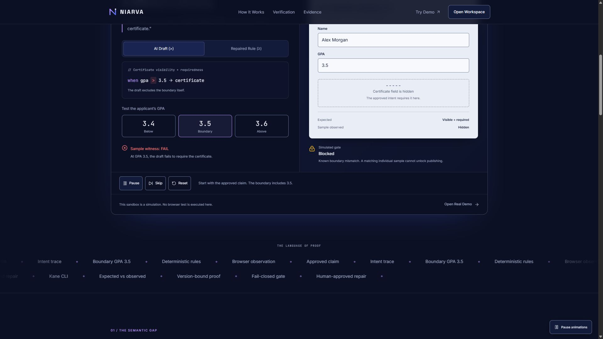
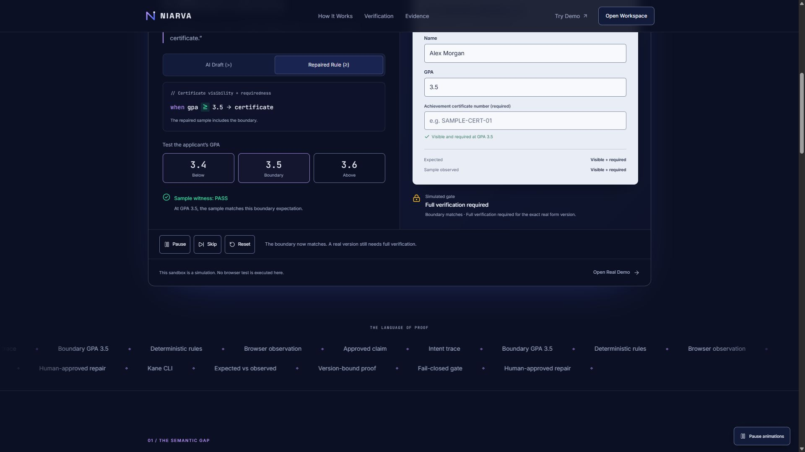

# Product experience source repairs

UI repair evidence uses this isolated namespace. Existing core-track evidence is unchanged. Original packs and detailed logs remain private; the files here are inspected, sanitized derivatives.

| Finding | Actual observation | Source change | Retest |
| --- | --- | --- | --- |
| Landing favicon | Kane console recorded one favicon 404 | Page metadata supplies the existing brand glyph as an inline icon | Same-objective retest records zero console errors; [chronology](../../product-experience/favicon-repair.md) |
| Sign-in favicon | PE-01 recorded favicon404 after leaving the landing route | Root metadata also supplies the existing inline brand icon | Integrated PE-01 has zero console errors; [chronology](./global-icon.md) |
| Replay manual activation | First manual GPA3.4 click was followed by GPA3.5 with replay still active; a later repeated click masked the overwrite | Cancel replay on radio activation, including the selected value; retain native change handling | Same objective/oracle retest PASS on its recorded build; [chronology and diff](./replay.md); affected regressions remain separate |

The replay run's vendor status was `passed`. Its intermediate screenshot contradicts the manual-choice requirement, so the assessment is **FAIL**. The source is repaired; the expected result is unchanged.

