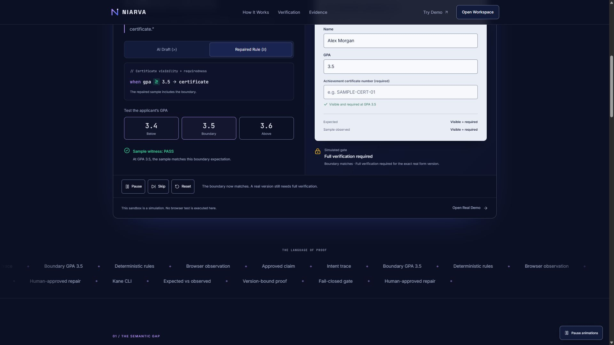
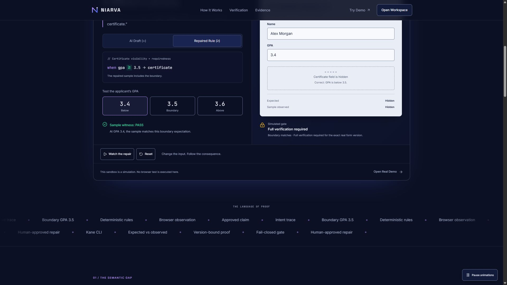
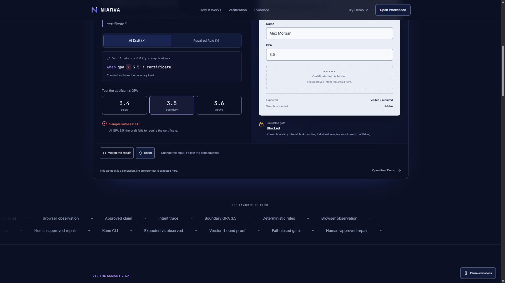

# Preserve manual input during replay

Requirement `UI-AC-12`. Objective hash `576d653a076748d897fcb7ba1e128b845b5d46499b740292cdd34d9321f78b7e`; execution-prompt hash `3e2d797574cd560a90844e5b9abecf05f7f548bcce9f9927bea1a2b35babbd81` is identical before and after the repair.

The [original run](../../product-experience/PE-02A-before.json) is assessed **FAIL**. Its first GPA3.4 activation is followed by a screenshot showing repaired GPA3.5 and active Pause/Skip controls. Kane then clicks3.4 again before its wait/assertion and reports `passed`. That late result masks the earlier overwrite; the screenshot and action chronology determine the assessment.

Radio inputs handled only `change`, which does not run when a selected option is activated again. Both rule and GPA inputs now cancel replay on `click` as well. Their existing change handling continues to set values and support keyboard selection. No expected result or timer duration changes.

After lint and production build, the [same-objective rerun](../../product-experience/PE-02A-after.json) has status **PASS** on build `71hvB9w7WGC229kZAmqAf`. The first manual activation shows GPA3.4 with replay stopped, and it stays3.4 after the requested wait without a corrective second activation. Pause remains paused; Skip shows repaired3.5 with full verification required; Reset ends on default draft3.5 with the simulated gate Blocked. Actual named values and final screenshots were reviewed. The [source diff](./replay.patch) preserves the repair.

The execution context now explicitly disallows a second corrective GPA input during the wait. Its hash change is recorded; the original objective, approved extraction supplement, and oracle are retained. Original packs remain private. The checked-in records are sanitized derivatives.

Affected boundary and full keyboard regressions run separately on the final application build. Their status is retained in the product-experience evidence index; this source repair does not imply release readiness.

