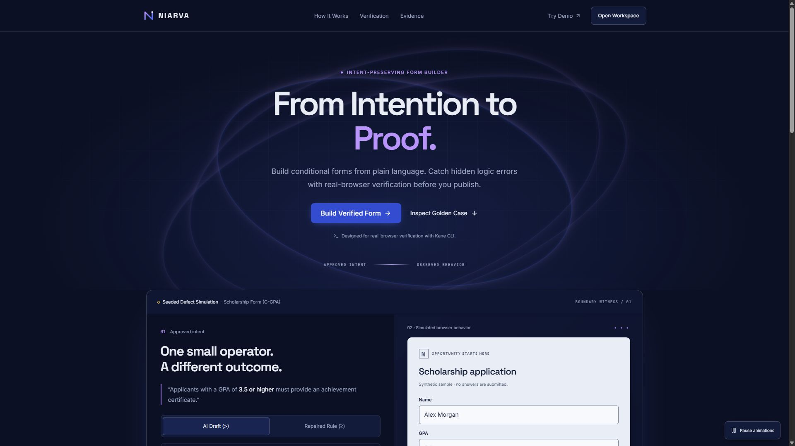
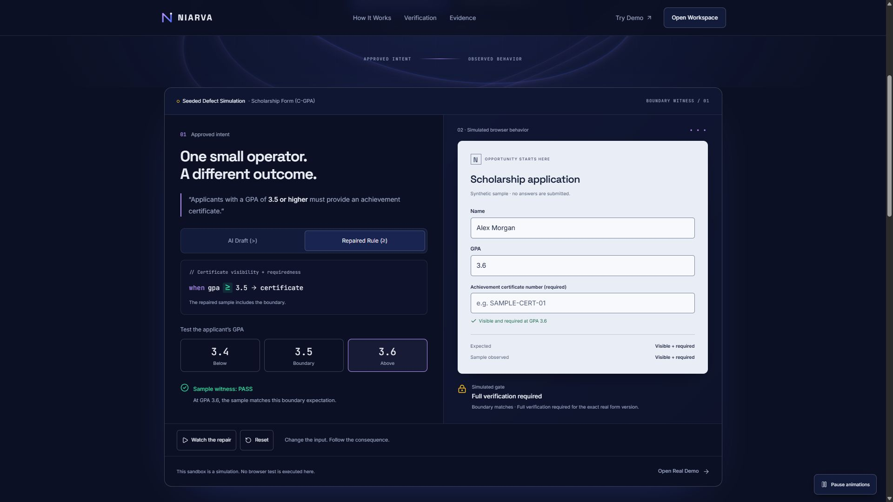

# Landing boundary verification

The landing demonstrates how a single comparator changes a scholarship form at GPA 3.5. It permanently labels the example as a seeded simulation, separates sample observations from real proof, and never offers a publishing action.

## Scope and provenance

- Test: PE-01; requirements UI-AC-01…06, UI-AC-14 and UI-AC-17.
- Objective reviewed before execution; SHA-256 `4539e39db7641cc3a7f2e945a77f4b9034f3027d3821f4ff48cadd72a777588c`.
- Kane CLI 0.10.4, production build `lygGe-iV5L1noSQeByyIb`, isolated local port 3101.
- Source base `e860ecfa73d15520f3d853cb91a4e8468df53e18`, plus the exact working source hashes in [PE-01.json](PE-01.json).
- Method: explicitly approved one-shot objectives. No claim of Assurance-generated coverage is made for this landing batch.

## Chronology

| Attempt | Started UTC, 17 November 2026 | Status | Credits | Explanation |
|---|---|---|---:|---|
| Initial | 14:43:28 | BLOCKED | 15.4994 | Browser could not reach the server across the process network boundary. No feature behavior was proven. |
| Same objective | 14:47:25 | PASS | 104.1362495 | Server was restarted in the reachable local execution context. All six boundary states and the real sign-in destination were observed. |

The second run finished at 14:54:13 UTC. Kane reported 366.4 seconds of execution and 31 completed progress events. Shared account balance was 9285.7888 before and 9118.9783 after; other concurrent account activity makes that delta different from this run's reported consumption.

The first attempt's private pack digest is `319daf64e7a58d0139e2666224bbcbcf3c244bf528543b46c70f6cccc9ba2d9c`. The passing run's private pack digest is `ed877b3e66034b6757af2fab0893f5f7300b7eca8d0dce033038380a25df5568`, session `cd10ce29-0004-41d1-a327-ab71e804b5c8`.

## Observed behavior

| Rule | GPA | Certificate | Sample witness | Simulated gate |
|---|---:|---|---|---|
| Draft `>` | 3.4 | Absent | PASS | Blocked |
| Draft `>` | 3.5 | Absent | FAIL | Blocked |
| Draft `>` | 3.6 | Visible and required | PASS | Blocked |
| Repaired `≥` | 3.4 | Removed and not focusable | PASS | Full verification required |
| Repaired `≥` | 3.5 | Visible and required | PASS | Full verification required |
| Repaired `≥` | 3.6 | Visible and required | PASS | Full verification required |

The gate was observed as explanatory text with an icon, without a real Publish action or actual VERIFIED result. Open Real Demo reached the supported sign-in screen. For the approved workspace-or-sign-in alternative, the sign-in branch was observed; anonymous access to the workspace itself was not claimed.

Kane omitted intermediate extraction keys from its final-state summary. The typed per-assertion observations retained in command context memory were compared with the expected boundary table, with the screenshots inspected as supporting evidence. Exit code or Kane's overall status alone was not treated as proof.

[View the formally named test case](https://test-manager.lambdatest.com/projects/01M7K3YXN5X28FCVQCMV3F4HN5/test-cases/01M7MZMCR7TY7SHJ8E2VSJY3J9/dashboard). This historical run remains in the original project. Subsequent tests use **NIARVA intent verification**.

## Verification boundary

These extracted screenshots and observations are sanitized derivatives, not the original sealed pack. They prove landing behavior on this local build. They do not prove a real form version, server persistence, product publication, narrow responsive layouts, or a release deployment. The network repair was an infrastructure correction, not a manufactured source defect.

Native lint on the changed source, workspace typecheck, and the corresponding production build passed. Shared API, schema, core, renderer, root layout, global stylesheet, and shared UI components were not changed.
