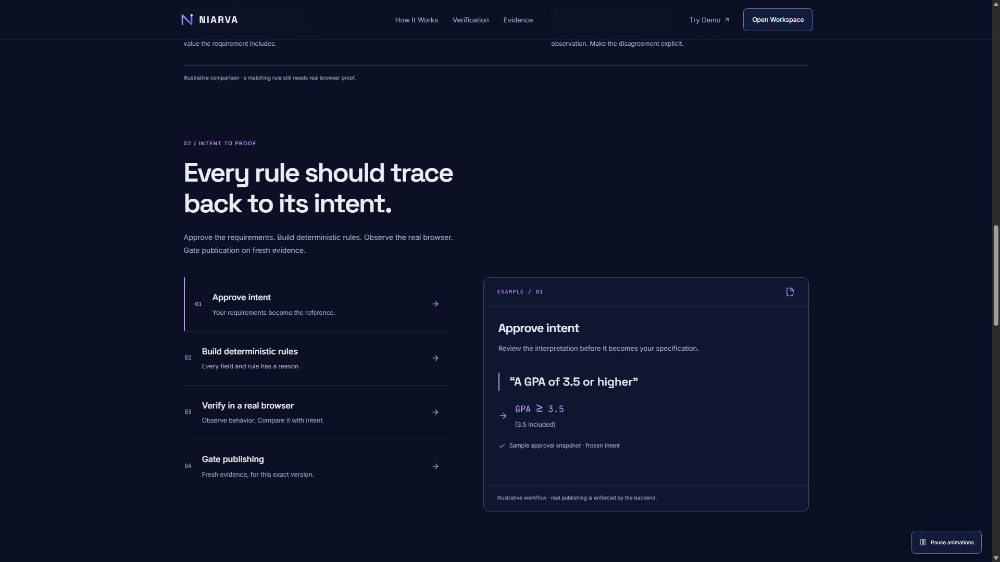
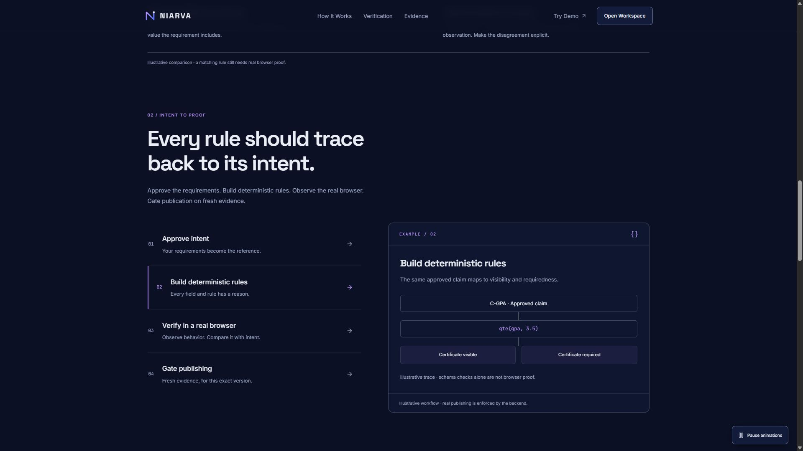
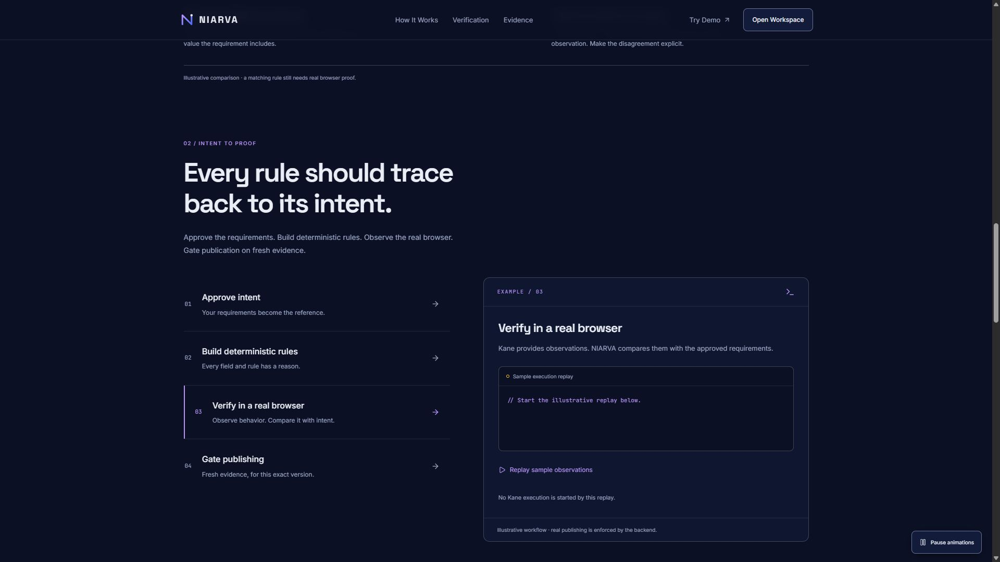
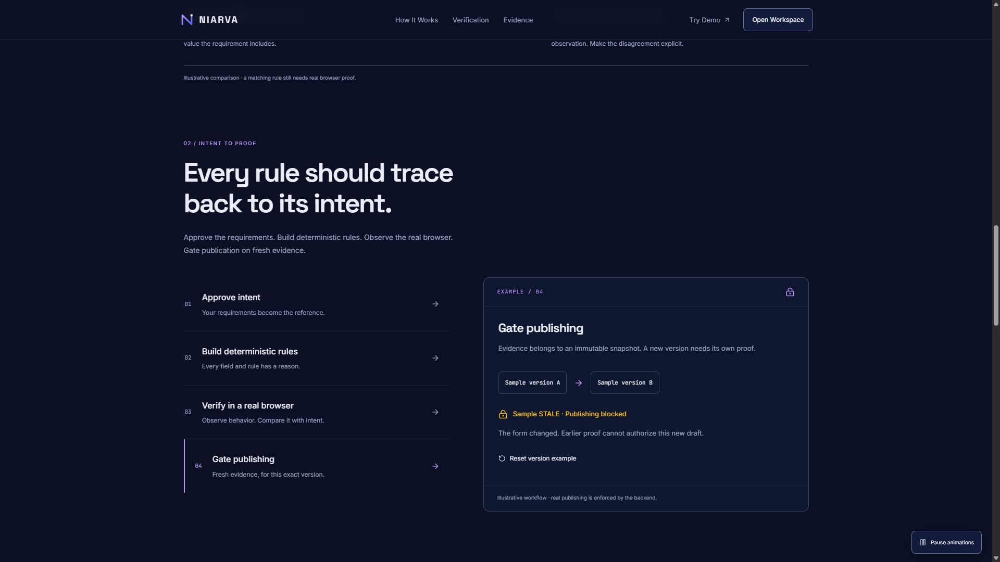

# Pipeline and stale publication gate

**PASS** — Kane PE-02B on production build `JLVIq5-Ze-0Gs92hwYHbh`, source `b3f2f3e`. This checks the labelled landing illustration, not real form verification or publication.

The four selected stages displayed their corresponding explanations: approved intent, deterministic rules, real-browser observations, and version-bound publishing. Kane's captured images were reviewed for every stage. Its typed observations confirm no unexpected focus movement. After the simulated version change, the sample became STALE and publishing remained blocked; the actual explanation was extracted and the final image retained that state.

| Observation | Expected | Observed |
| --- | --- | --- |
| Selected stage matches its explanation | true | true |
| Focus moved unexpectedly | false | false |
| Sample STALE | true | true |
| Publishing blocked | true | true |

The recorded console has no errors; all 26 recorded requests returned HTTP 200. [Sanitized observations, hashes, case identity, and chronology](./PE-02B.json) retain the original and execution-prompt hashes separately. The owner approved the extraction clarification; original assertions and oracle remain unchanged. Earlier incomplete umbrella executions remain BLOCKED in [their history](./narrative-progress.md).

