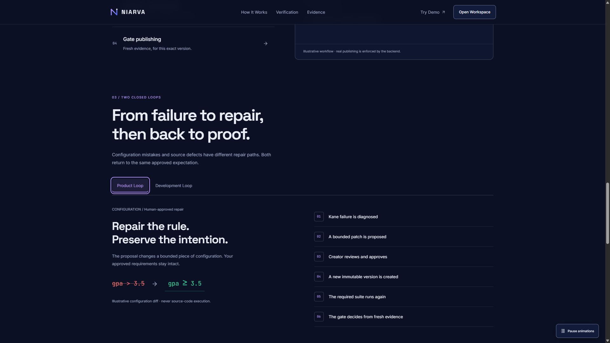
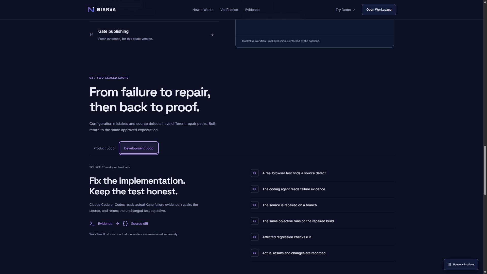

# Product and development loop verification

Both owner-reviewed atomic cases **PASS** on build `JLVIq5-Ze-0Gs92hwYHbh`, source `b3f2f3e`.

| Case | Status | Observed result |
| --- | --- | --- |
| [PE-02C-PRODUCT](./PE-02C-PRODUCT.json) | PASS | Click and arrow-key switching ends on Product Loop. Selected tab and panel agree; creator review and approval is required. Actual explanation and final focus are retained. |
| [PE-02C-DEVELOPMENT](./PE-02C-DEVELOPMENT.json) | PASS | Click and arrow-key switching ends on Development Loop. Selected tab and panel agree; the text describes source repair and rerunning the unchanged objective. Actual explanation and final focus are retained. |

The named `loop_tabs` outputs contain actual selected labels and visible explanations. Final Kane screenshots confirm the required selected panels and visible keyboard focus. Both recorded consoles are error-free; recorded requests returned HTTP 200.

Earlier combined attempts remain BLOCKED: [attempt 1](./PE-02C-attempt-1.json), [attempt 2](./PE-02C-attempt-2.json). Their checkpoint evaluated Product approval while Development was selected. Those results and their original hashes are preserved. The owner reviewed the atomic execution design; both original descriptions and the click/keyboard expectations remain required.

These are labelled workflow illustrations. They do not execute a product repair or publish a form.

