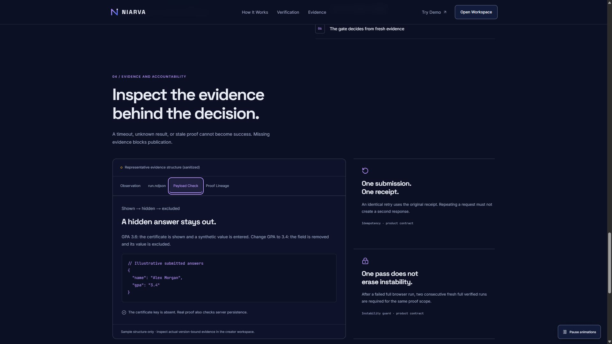
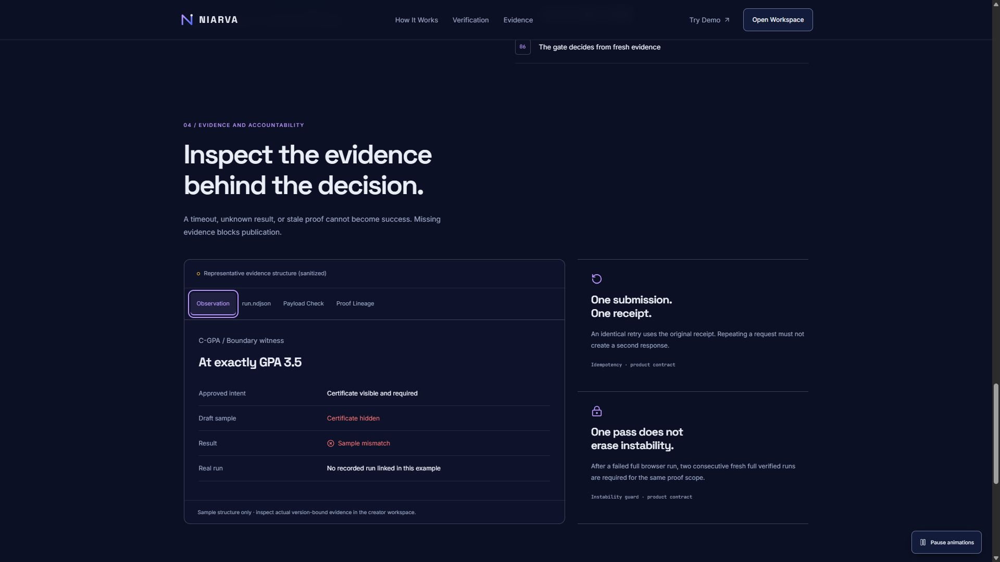

# Evidence inspector observations and final return

The inspector's four views and keyboard return are covered by two actual runs on the same build `JLVIq5-Ze-0Gs92hwYHbh` and identical landing source hashes.

| Record | Execution status | Evidence |
| --- | --- | --- |
| [PE-02D observations](./PE-02D-observations.json) | BLOCKED | All four selected views have matching labelled sample content; no real identifiers are invented. The certificate is excluded from the payload example and its actual explanation is extracted. The run reopened Payload Check after returning to Observation, so the final-order requirement was incomplete. |
| [PE-02D-END](./PE-02D-END.json) | PASS | Keyboard navigation reaches Proof Lineage and returns to Observation. The final selected tab, corresponding panel, visible focus, non-overlap, and actual `inspector_return` values all match. The last screenshot remains on Observation. |

The owner reviewed the atomic final-return case as a supplement to the same-build panel observations. The original incomplete run remains BLOCKED. This coverage does not relabel it or count an extra execution. Original objective, execution prompt, and supplement hashes are retained separately.

Both recorded consoles contain no errors, with 20 recorded HTTP 200 requests per run. All content remains explicitly illustrative; no real verification or publication is claimed.

