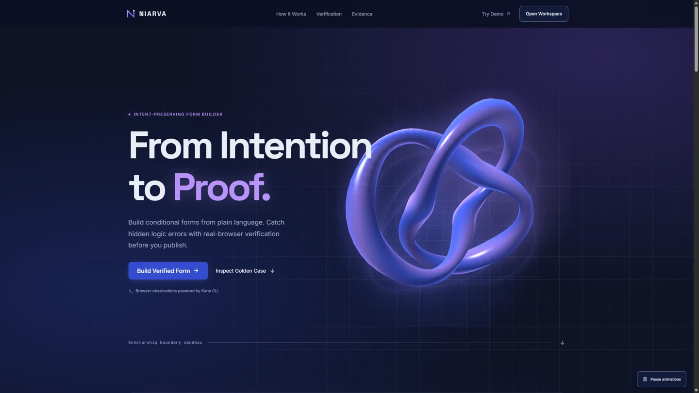

# Cinematic landing verification

PE-05 verified the desktop landing at 1920 px on local build `Ht8pfDR5t3PM8Fo9Kbqtr`. The hero rendered the WebGL knot and particles. Activating **Pause animations** removed the moving scene and left the static CSS portal and primary action visible. **Resume animations** and the Verification link remained usable. The Semantic Gap comparison showed the approved boundary, the draft operator, and a missing test field keeping publication blocked in the labelled sample.

[Paused hero](./cinematic-paused.jpg) · [Semantic Gap](./cinematic-semantic-gap.jpg) · [Run identity and observations](./PE-05-desktop.json) · [Test Manager case](https://test-manager.lambdatest.com/projects/01M7N0CKZ90R3JR906713EHYW0/test-cases/01M7PFQZW2FP6WD4146JFDVV6R/dashboard)

The first two attempts loaded stale assets from the previous preview server on IPv6 localhost. Their browser evidence shows HTTP 500 responses and missing hydration. After stopping that listener, the same PE-05 objective passed on the same production build. The successful pack recorded 21 first-party HTTP 200 responses and zero console errors. The earlier attempts remain [BLOCKED for hero](./PE-05-preview-conflict.json) and [BLOCKED for GPA](./PE-01-redesign-preview-conflict.json).

Lint, typecheck, production build and all 88 native tests passed. The build prerenders both the landing and the judge guide. Seven new text and focus color pairs meet their measured contrast targets. Initial JavaScript is estimated at 213,065 gzip bytes from production HTML references. The shader loads separately when the hero is visible.

The [PE-01 regression](./PE-01-cinematic-regression.json) passed all six draft and repaired GPA combinations with the original oracle. The hidden certificate input leaves the focus order, the gate still requires evidence, and the workspace route reaches sign-in. The local pack has 29 first-party HTTP 200 responses and zero console errors. The [sandbox screenshot](./cinematic-sandbox.jpg) shows the repaired 3.5 sample and its publication gate.

[PE-06](./PE-06-judge-guide.json) followed the landing's closing link to `/demo`, captured the three actual guide destinations and reached the private workspace sign-in screen. The run recorded zero console errors, 66 HTTP 200 responses and one expected redirect. [Guide screenshot](./cinematic-judge-guide.jpg) · [Test Manager case](https://test-manager.lambdatest.com/projects/01M7N0CKZ90R3JR906713EHYW0/test-cases/01M7PG8KBS32VCK7BY9J035H30/dashboard)

[PE-03K](./PE-03K-cinematic-regression.json) completed 63 desktop keyboard steps. The final screenshot shows the visible sapphire focus ring on **Resume animations**, clear of the sticky header. The workspace action and sandbox remain keyboard reachable. The pack records zero console errors and 50 HTTP 200 responses.

The 12 captured UI source file hashes match commit `501e390`. The GPA and keyboard recording bundles synced after an audit. Their local packs and sanitized derivatives provide the review trail for these specific runs.

The actual 360 px viewport and active reduced-motion preference remain BLOCKED. Production smoke is NOT RUN. The paused desktop screenshot demonstrates the static portal without establishing that the system reduced-motion setting was exercised.
