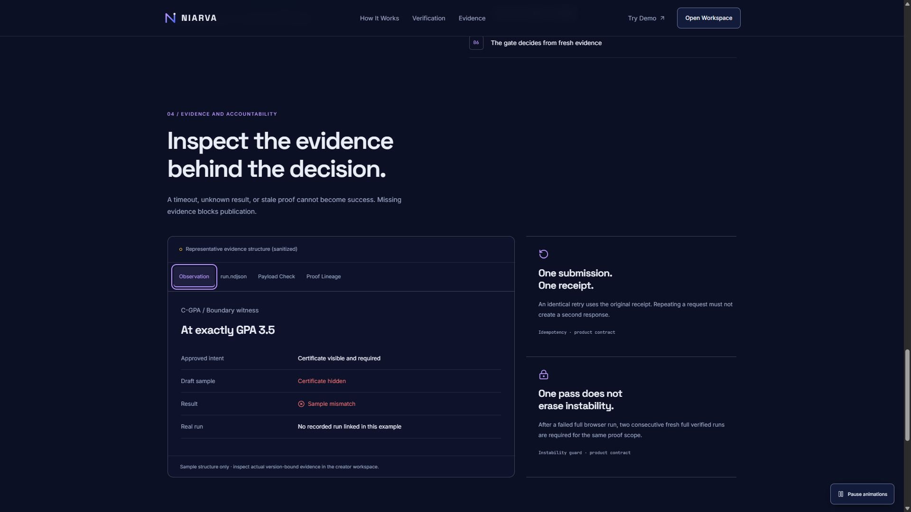

# Landing narrative verification progress

The landing adds an intent-to-proof pipeline, product and development workflow tabs, a labelled evidence inspector, and static motion fallbacks. These are illustrative product explanations. They do not represent an executed product verification or authorize publication.

Source snapshot: production build `j40Kd5rcJzc0sxJ1FNiEL`. Exact file hashes, objective hashes, timestamps, command consumption, observed values, and original failure chronology are retained in [the sanitized record](./narrative-progress.json). Original packs and detailed logs stay private.

| Test | Status | Assessment |
| --- | --- | --- |
| PE-02, initial | BLOCKED | Agent checked mutually exclusive inactive panels together, missed an extraction, and omitted the final return. This did not establish a product defect. |
| PE-02, retry | BLOCKED | Driver watchdog interrupted the run. No terminal event or sealed pack. |
| PE-02D, inspector | BLOCKED | Seven typed checks match: each selected panel's labelled content, certificate exclusion, keyboard return, and layout. The required named explanation extraction contains a literal placeholder, so the full objective is incomplete. |
| PE-03, initial | BLOCKED | UI process stopped after discovering a concurrent worker held the machine lock. The same objective is queued through that lock. |
| PE-04 | NOT RUN | Motion preference verification pending. |

PE-02's unchanged clauses are divided into four bounded executions. The original objective remains intact; completion requires every clause. No generated test has been edited to manufacture a pass.

The inspector case is in **NIARVA intent verification**, ID `01M7N3DVRBZAMFD62QMTNPEWHB`, with the verified formal title **NIARVA landing: evidence inspector provenance and payload exclusion**. Its initial bundle sync failed at presign. A local audit of the exact official five-file collection found no known secrets, credentials, confidential document references, or browser profile files; the supported sync command then succeeded. This preserves the historical result rather than creating a replacement execution.

Native validation is separate: lint, TypeScript, and production build passed. A control boundary initially measured 1.859:1 contrast; a scoped color correction improved it to 4.02:1 against the canvas and 3.60:1 on the raised surface. All 14 measured color pairs meet their declared thresholds. The production HTML references 212,480 gzip bytes of initial JavaScript; this is a static asset estimate, not a browser performance measurement.

Responsive widths, mobile menu, browser zoom, reduced motion, the remaining replay checks, and final deployment smoke remain unproven. This report does not establish release readiness.
